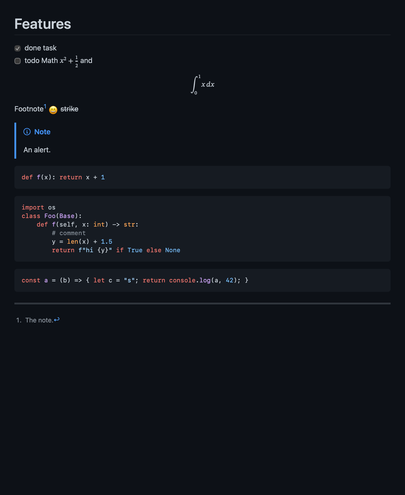

# MD Preview

Double-click a `.md` file on your Mac to see it formatted, GitHub style. Double-click any word to edit it there. Cmd+E switches back.



```sh
brew tap devinjones812/md-preview https://github.com/devinjones812/md-preview
brew trust devinjones812/md-preview
brew install md-preview
```

Or from source: `brew install pandoc && ./build.sh --install`. Then choose **MD Preview → Set as Default for .md Files**.

Built with Swift, [pandoc](https://pandoc.org), and [highlight.js](https://highlightjs.org). Stylesheet from [QLMarkdown](https://github.com/sbarex/QLMarkdown). GPL-3.0.
